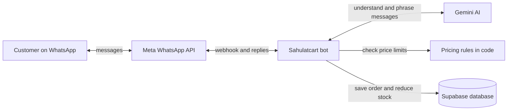

# Customer side — current system

The customer asks about products and agrees on a price with the bot. Code enforces the merchant's price limits; Gemini helps understand messages and write replies but does not set prices. The bot collects delivery details, confirms COD or requests a bank-transfer screenshot, and sends an order slip through WhatsApp.

For a bank transfer, the money goes directly to the merchant. The screenshot is stored privately until the merchant verifies or rejects it in the portal. The merchant handles delivery. See the [merchant side](MERCHANT-SIDE-ARCHITECTURE.md) for those actions.
