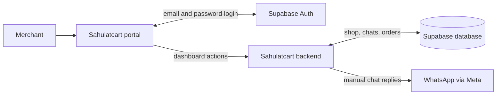

# Merchant side — current system

The merchant uses the portal to manage products, prices, bot settings, conversations, orders, and notifications. A bank-transfer screenshot appears with its order so the merchant can verify or reject the payment. The merchant fulfills the order outside Sahulatcart.

**Current setup:** Accounts are created through an invite-only admin operation, then merchants sign in with email and password. Facebook sign-in and automatic WhatsApp number connection are not implemented yet. The portal sends its API calls through its own Next.js proxy to the backend.

See the [customer side](CUSTOMER-SIDE-ARCHITECTURE.md) for what happens when a buyer messages the shop.
