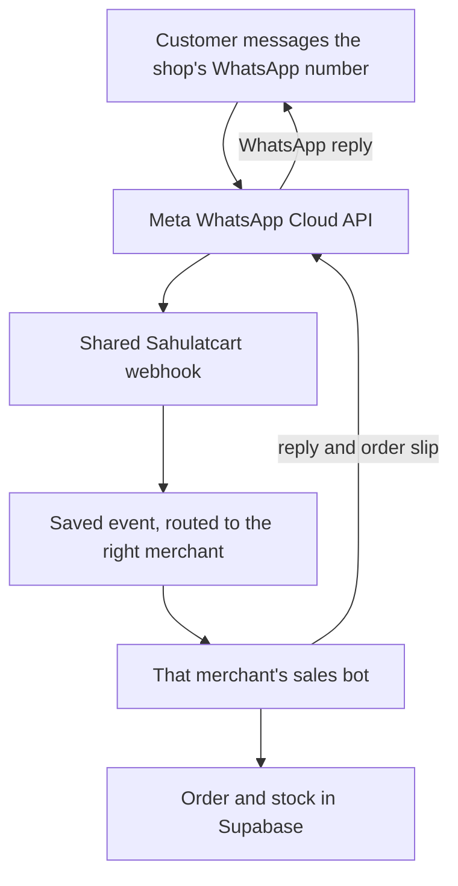

# Customer side after multi-merchant WhatsApp onboarding

**Proposed architecture — not implemented yet.** Each merchant uses their own connected WhatsApp Business number. Sahulatcart operates one shared Meta app and webhook, while processing each shop's data separately.

## What happens behind the diagram

1. The webhook verifies Meta's signature and saves each event durably before acknowledging it. A unique message ID and idempotent order operations prevent duplicate orders. An outbound-send record helps the worker avoid repeat replies when it retries after a failure. Messages are processed in order for each buyer, and unfinished events can be retried after a restart.
2. Meta's `phone_number_id` selects the merchant. Every catalog lookup, conversation, order, screenshot, and outbound message is scoped to that `merchant_id`. The sender retrieves only that merchant's encrypted WhatsApp credential; one merchant's token or products must never be used for another merchant's customer.
3. Gemini understands Roman Urdu and helps word replies. Deterministic code decides the price, checks stock, and guards the final reply. The bot gathers delivery details and offers COD or a transfer into the merchant's own bank account.
4. On confirmed order placement, one database transaction saves the order and reduces tracked stock, or fails without placing the order if stock is unavailable. The backend generates a slip and sends it through the merchant's WhatsApp number. A bank-transfer screenshot is stored privately and shown to the merchant for manual **verify/reject**; the bot must not claim that the money arrived merely because a screenshot was sent.
5. The merchant sees the conversation, order, and payment claim in the portal. They can take over the chat or pause the bot. They fulfill the order; Sahulatcart does not arrange delivery or receive the buyer's money.

**Implementation needed:** A durable webhook inbox/worker boundary, outbound-send tracking, transactional order placement with stock reservation, per-merchant credential selection, connection-state handling, and end-to-end tests with two merchants to prove tenant isolation. The existing bot, price rules, portal, and payment review can be extended rather than replaced.

See the separate [merchant onboarding flow](TARGET-MERCHANT-ONBOARDING.md).

## References

- [Meta's Embedded Signup API collection](https://www.postman.com/meta/whatsapp-business-platform/documentation/du6gzjv/embedded-signup)
- [Meta's WhatsApp Cloud API collection](https://www.postman.com/meta/whatsapp-business-platform/documentation/wlk6lh4/whatsapp-cloud-api)
