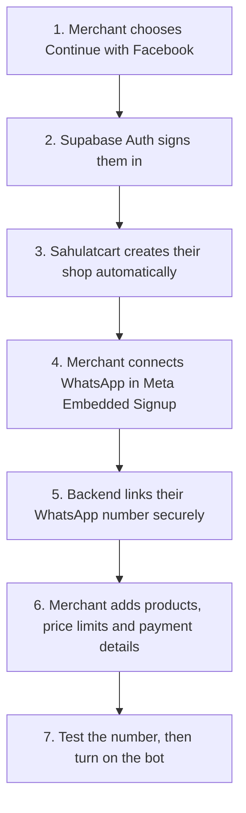

# Merchant side after Meta Tech Provider approval

**Proposed architecture — not implemented yet.** This is how merchant onboarding should work once the Meta app has the required business verification, App Review, permissions, and Embedded Signup configuration.

## What each step means

1. **Facebook sign-in is for the portal.** Supabase Auth creates or resumes the merchant's Sahulatcart login session. On the first successful sign-in, the backend creates one `merchants` row and one owner `merchant_users` row for that authenticated identity. Repeating the callback must find the same shop instead of creating another one. A returning merchant signs in the same way; they do not repeat WhatsApp connection on every visit.
2. **WhatsApp connection is a separate Meta permission flow.** The merchant clicks **Connect WhatsApp** in the portal. Meta Embedded Signup lets them choose or create their business portfolio and WhatsApp Business Account (WABA), select or add their business number, verify control of the number, and grant Sahulatcart access. The Facebook portal-login session is not the WhatsApp sending credential.
3. **The backend finishes the connection.** It completes Meta's server-side authorization handoff, checks that the returned WABA and phone-number IDs match the grant, stores the merchant-scoped credential encrypted, subscribes the shared app webhook to the WABA, and registers the phone when Meta requires it. It records `phone_number_id → merchant_id` and keeps the channel in `connecting` or `needs_attention` until the required steps and a test send/receive succeed. Tokens stay out of browser storage, logs, and chat messages. A revoked grant changes the channel to `disconnected` and asks the owner to reconnect.
4. **The merchant sets selling rules.** They add a catalog, tracked stock, minimum prices or discount limits, delivery charge, COD settings, and their own bank account for transfers. The bot can only go live after a connected number and enough product/payment information exist. The merchant can pause the bot, take over a conversation, verify or reject payment screenshots, and fulfill orders themselves.

The merchant owns the WABA and phone number. Tech Provider status does not itself give Sahulatcart a Solution Partner credit line; Meta billing or payment setup must follow the specific onboarding model approved for the app. A number already active in another WhatsApp product may need a supported migration or coexistence path, so the portal must show that case rather than promise an automatic transfer.

**Implementation needed:** Facebook OAuth in Supabase; an idempotent first-login merchant creation endpoint/transaction; Embedded Signup UI and callback; secure per-merchant credential storage and selection in the WhatsApp sender; WABA subscription and number registration; connection health/reconnect states; readiness checks. The current code has email/password login, invite-only merchant creation, and a single platform WhatsApp token.

See the separate [customer-side target flow](TARGET-CUSTOMER-SALES-FLOW.md).

## References

- [Supabase: Sign in with Facebook](https://supabase.com/docs/guides/auth/social-login/auth-facebook)
- [Meta: Tech Providers and Embedded Signup](https://whatsappbusiness.com/partners/become-a-partner/)
- [Meta's Embedded Signup API collection](https://www.postman.com/meta/whatsapp-business-platform/documentation/du6gzjv/embedded-signup)
- [Meta's Cloud API registration guidance](https://www.postman.com/meta/whatsapp-business-platform/documentation/wlk6lh4/whatsapp-cloud-api)
- [WhatsApp Business Platform onboarding guide](https://whatsappbusiness.com/resources/resource-library/api-onboarding/)
